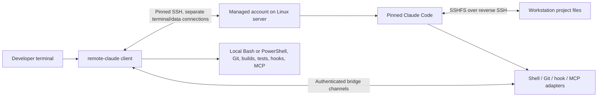

# Remote Claude

Remote Claude is a self-hosted SSH bridge for [Claude Code](https://code.claude.com/). It runs the Claude Code interface and conversation state on a Linux server you control, while a workstation can keep ownership of the project files, commands, builds, hooks and MCP servers. A separate server mode runs a committed task entirely on the server, inside tmux and Docker, so the workstation can disconnect.

The same Go executable provides the workstation client, the server, the temporary SSH/SFTP bridge and command dispatcher. No inbound port, SSH server, Node.js or Python installation is required on the workstation.

> **Scope and fair use.** Remote Claude is not affiliated with Anthropic. It can make network egress and session management more consistent across devices, but it does not guarantee that an account will not be restricted and must not be treated as a way to bypass provider rules. You are responsible for complying with the Claude terms and subscription limits. Linux accounts on the server do not create additional subscription quotas.

## Why it is useful

- **One controlled Claude environment.** Claude Code, its version and its authorization live on the server instead of being independently installed and updated on every workstation.
- **Consistent network egress.** Claude traffic originates from the server. An administrator can additionally route managed users through a controlled VPN or egress gateway; the project does not require a particular VPN product.
- **No refresh-token race between workstations.** Managed server accounts can share one server-side login. A single systemd timer refreshes it and distributes updated OAuth state to managed accounts. OAuth tokens are not copied to workstations.
- **Native workstation toolchain.** In local mode, source files stay on the workstation. Bash/PowerShell, Git, builds, tests, hooks and supported MCP servers use the workstation's actual OS, environment and installed dependencies. There is no project synchronization step.
- **No exposed workstation service.** The client listens on loopback and exposes the temporary bridge only through reverse SSH forwarding. Router changes and inbound firewall rules are unnecessary.
- **Work that survives disconnection.** Interactive sessions reconnect after transport failures. Server mode keeps the task in tmux and can continue after the workstation is switched off.
- **Auditable releases.** Release archives are built by CI from an exact version tag. The source commit is embedded in each executable and recorded in the update manifest; archive contents and SHA-256 hashes are checked before publication.

### Operational consistency for teams

Where the organization's Claude terms and subscription permit this deployment, keeping Claude Code on a single administrator-managed host with a controlled egress path gives the team one consistent managed environment and network route instead of frequent ad-hoc workstation and network changes. It can reduce manual sign-in and refresh churn and make access administration easier to audit.

This reduces operational variability only. It does not prevent provider enforcement, authorize account sharing, remove human oversight, or override subscription or device rules.

## Two operating modes

| Mode | Claude and conversation | Project files | Commands and builds | Works with workstation off |
|---|---|---|---|---|
| Local bridge (default) | Server | Workstation, mounted through SSHFS | Workstation | No |
| Server mode (`--server`) | Server, in tmux/Docker | Server clone fetched from `origin` | Server container | Yes |
| Existing server checkout (`night`) | Server, in tmux/Docker | Existing server checkout | Server container | Yes |

Local mode is intended for interactive development in a working tree. Server mode starts from a **committed and pushed** commit; uncommitted and unpushed changes are never transferred. `night` reuses an existing Git checkout on the server and does not prepare a new branch.

## Local bridge architecture



The terminal and data connections are established in parallel. The data connection carries a reverse-forwarded, per-session SSH/SFTP bridge. A private Unix-socket executor reuses that authenticated connection for Git, shell, hooks and MCP dispatch instead of performing a new handshake for every command.

The workstation listener is bound to `127.0.0.1` with an ephemeral port. Each session has a random secret and an ephemeral bridge host key. The server's SSH host key is pinned by the SHA-256 fingerprint from the invitation; only Ed25519 server host keys are accepted.

See [docs/ARCHITECTURE.md](docs/ARCHITECTURE.md) for transport, caching, filesystem, configuration projection and reconnect details.

## Features

### Workstation integration

- Native `CLAUDE.md`, nested instructions, `.claude/rules`, skills, commands, agents and project/local settings are visible in the mounted repository.
- Command and HTTP hooks execute on the workstation, including exec-form hooks and `CLAUDE_ENV_FILE` propagation.
- stdio MCP servers run locally. HTTP/SSE MCP connections and HTTP hooks originate from the workstation, including access to its localhost and VPN.
- Bash and PowerShell adapters preserve stdout, stderr, exit status and working-directory changes. Commands receive the workstation environment plus project `env` settings.
- The project filesystem is rooted at the selected directory. Read, write, rename, mkdir, remove, symlink, link and metadata operations are supported through SFTP.
- Small files are read in one request; ordinary file contents are not cached between opens. Short metadata/configuration caches and workstation ripgrep reduce high-latency round trips.
- `--fresh-metadata` disables the short caches and selects the slower native configuration discovery path.
- `--check` exercises SSH, file operations, local command execution and local-edit visibility without calling the model.

### Reliability

- Interactive local sessions reconnect and continue the selected conversation after an SSH drop.
- Server sessions reattach to the existing tmux task without creating another branch or rebuilding the container.
- Retry delays increase from 1 to 16 seconds. `Ctrl+C` stops reconnect attempts.
- Non-interactive `--print` requests are **not** automatically repeated.
- A command interrupted by a transport failure is not blindly replayed: it may already have run, so its result must be checked.
- The server watchdog terminates a Claude process whose workstation bridge has disappeared and can abort a stale FUSE mount.

### Server mode

- Clones/fetches `origin`, verifies that the workstation's current commit exists there and creates a `claude/<branch>-<timestamp>` branch.
- Keeps tasks in per-user tmux sessions and existing checkouts under `~/server-jobs/`.
- Uses the project's `.remote-claude/Dockerfile`, or a default Ubuntu 24.04 image with Git, Go, Node.js, Python and build tools.
- Runs containers with the developer's UID/GID, dropped capabilities, `no-new-privileges`, a PID limit and no Docker socket.
- Supports up to two tmux jobs per account and eight subagents in a server job.
- Provides optional systemd CPU, memory and task limits for local and server workloads, plus relative I/O weighting for the server pool.
- Detects an already running job for the same repository under another account on a best-effort basis; `--force-new` deliberately bypasses that check.
- Pre-approves a small set of Git/PR commands and rejects common force-push/merge spellings through Claude permissions. **Real merge protection requires Git-host branch protection and a token without merge rights.**

## Client quick start

Requirements:

- Linux, macOS or Windows on amd64 or ARM64;
- a release archive for the platform;
- a personal `remote-claude-NAME.json` invitation from the server administrator;
- project-specific local tools (Git, compilers, Docker and so on) only if the project needs them.

1. Download the appropriate archive and `SHA256SUMS` from [Releases](../../releases/latest), then verify the archive checksum.
2. Extract it and run the installer:

   ```sh
   # Linux / macOS
   sh ./install.sh /secure/path/remote-claude-NAME.json
   ```

   On Windows, extract the ZIP and double-click `install.cmd`, or run:

   ```powershell
   powershell -NoProfile -ExecutionPolicy Bypass -File .\install.ps1 -Invitation C:\secure\path\remote-claude-NAME.json
   ```

3. Start from the project directory:

   ```sh
   remote-claude --check .
   remote-claude .
   ```

4. To use an HTTP CONNECT proxy for SSH:

   ```sh
   remote-claude --proxy --proxy-host 127.0.0.1 --proxy-port 10809 --check .
   remote-claude --proxy .
   ```

   The default proxy address is `127.0.0.1:10809`; no proxy is used unless `--proxy` is present.

The invitation contains a one-time bootstrap private key and is sensitive. `setup` generates a separate workstation Ed25519 key, enrolls only its public key and stores the profile without the bootstrap key. Delete the invitation after successful enrollment. Do not send it in chat, attach it to an issue or store it in a repository.

The full Russian client guide is in [QUICKSTART.ru.md](QUICKSTART.ru.md).

## Everyday commands

```sh
remote-claude .                         # open a project
remote-claude --check .                 # diagnostics without a model call
remote-claude --resume .                # conversation picker
remote-claude --resume=SESSION_ID .     # a specific conversation
remote-claude --continue .              # latest conversation, no picker
remote-claude --print "Explain this" .  # one non-interactive request
remote-claude ssh                       # shell on the server
remote-claude --server .                # pushed task on the server
remote-claude --server --resume .       # resume its checkout/conversation
remote-claude night /absolute/checkout  # existing server-side checkout
remote-claude version                   # version and source commit
```

Use `--profile NAME` to select a non-default connection profile. Arguments after the project and `--` are passed to Claude Code, for example:

```sh
remote-claude . -- --model sonnet
```

For server mode, push the current commit first. Configure Git hosting credentials on the server with `remote-claude ssh` and `gh auth login`, or provide an SSH key for an SSH `origin`.

## Self-hosting overview

The supported server layout is Ubuntu Linux with systemd, OpenSSH, Python 3 and an Ed25519 SSH host key. Local mode additionally needs `sshfs`; server mode needs Docker, tmux and sudo. The current adapter is pinned to **Claude Code 2.1.292** and deliberately disables its automatic updater.

The fixed server installation prefix is `/opt/remote-claude`. To install:

1. Clone this repository on the server and check out the desired `vX.Y.Z` release tag.
2. Install the supported Claude Code version for an administrator, then build the release:

   ```sh
   python3 scripts/build-release.py
   ```

3. Install server files without creating users or copying root credentials:

   ```sh
   sudo python3 -I scripts/install-server.py \
     --claude-binary /absolute/path/to/claude \
     --ripgrep /absolute/path/to/rg
   ```

   `--ripgrep` is optional. Use `--server-binary` to select a non-default server architecture/build.

4. Create the first managed account, replacing the placeholders:

   ```sh
   sudo python3 -I /opt/remote-claude/add-account.py \
     --host ssh.example.com developer
   ```

5. Log in to Claude once under that managed account, then run the authorization synchronizer:

   ```sh
   sudo -iu developer
   DISABLE_AUTOUPDATER=1 /opt/remote-claude/claude
   # Complete /login, verify the account, then exit.
   exit
   sudo systemctl start remote-claude-auth-sync.service
   ```

6. Transfer `/root/remote-claude-invitations/remote-claude-developer.json` to the user through a secure channel. Subsequent accounts can be created and downloaded from an administrator workstation:

   ```sh
   python3 scripts/new-invitation.py --host ssh.example.com seconddeveloper
   ```

   Add `--resources` only when Docker/tmux resource limits and server mode should also be configured.

The complete server guide, including egress routing, resource policies, updates, revocation and recovery, is in [ADMIN.ru.md](ADMIN.ru.md).

## Configuration compatibility

| Configuration | Behavior |
|---|---|
| `CLAUDE.md`, nested instructions, `.claude/rules` | Read natively from the mounted project |
| `.claude/settings.json`, `settings.local.json` | Project/local settings and `env` are applied |
| Skills, commands, agents, output styles | Visible to Claude; supported YAML-frontmatter hooks are adapted |
| Command hooks | Run on the workstation; JSON I/O and exit status are preserved |
| HTTP hooks | Sent from the workstation |
| stdio MCP | Started on the workstation with local environment/PATH |
| HTTP/SSE MCP | Proxied through the bridge so the connection originates on the workstation |
| Personal workstation `~/.claude` | Not imported |

Executable configuration entries are temporarily shown to Claude as transport adapters and converted back when written. A Claude `Read` of these entries can therefore differ from what a local editor displays.

## Security and trust model

- Server SSH is authenticated by a pinned host fingerprint; enrollment is one-time and replaces the bootstrap key with a workstation public key.
- OAuth tokens remain in managed server home directories. Any managed user who can read their own server copy must be trusted; Linux accounts are not a hard security boundary against the server administrator.
- Workstation commands run with the full rights of the local user and are **not sandboxed to the project**. Only the SFTP/search path layer is rooted.
- Server containers isolate toolchains and resource usage, not hostile users: they mount the user's home, use host networking and build project Dockerfiles with root build steps. Enable server mode only for trusted participants.
- Client updates arrive over the pinned SSH connection and are checked against SHA-256 hashes from the server manifest. There is no independent update signature; the server administrator is part of the trust boundary.
- Release archives contain no invitations, OAuth files, private keys, administrator guide or local verification reports. CI also scans Git history for credentials.

See [SECURITY.md](SECURITY.md) for reporting and deployment recommendations.

## Known limitations

- The adapter is verified against Claude Code 2.1.292; other versions require explicit testing and a source change.
- Local mode depends on network RTT. Caches reduce round trips but do not make remote reads instantaneous. Local editor changes normally become visible after short cache expiry plus network delay; OS inotify events are not forwarded.
- Windows retains its native case, locking, ACL and symlink semantics. Bash hooks on Windows require a Bash implementation such as Git for Windows. PowerShell `-File` adaptation is not supported in the pinned version.
- Persistent `cd` outside the exported project is rejected. Local commands can still use absolute paths with the user's normal permissions.
- LSP-heavy plugins, plugins with their own binary/JavaScript integrations, third-party MCP OAuth, automatic worktrees outside the exported tree and Claude's native OS sandbox are not adapted.
- Server mode requires pushed work and trusted users. Its parallel-job check is non-atomic and observes running containers only.
- Resource limits apply to new managed sessions after administrator configuration; direct unmanaged Claude processes bypass them.
- Linux is the primary tested platform. Windows and macOS archives are cross-compiled, but their installers and runtime behavior still require validation on physical systems before making stronger support claims.

## Build, test and release

Go 1.26 with the toolchain from `go.mod` and Python 3 are required for development. The builder can use Docker if `go` is not on `PATH`.

```sh
go test -race ./...
go vet ./...
python3 -m unittest discover -s scripts -p 'test_*.py'

# Local-only artifacts; explicitly marked development=true:
python3 scripts/build-release.py --dev
python3 scripts/check-release.py --dev
```

A real release build has no `--dev` escape in CI: the worktree must be clean, `HEAD` must equal `v<version>`, and the version must be newer than every previous release tag. Development manifests are rejected by the client updater.

Pushing a `v*` tag runs tests, secret scanning, six cross-platform builds, archive/provenance checks and GitHub Release publication. See [RELEASING.md](RELEASING.md).

## Documentation

- [Architecture and protocol details](docs/ARCHITECTURE.md)
- [Руководство пользователя](QUICKSTART.ru.md)
- [Администрирование сервера](ADMIN.ru.md)
- [Security policy and threat model](SECURITY.md)
- [Release process](RELEASING.md)
- [Changelog](CHANGELOG.md)

## License

MIT. See [LICENSE](LICENSE) and [THIRD_PARTY_NOTICES.txt](THIRD_PARTY_NOTICES.txt).
